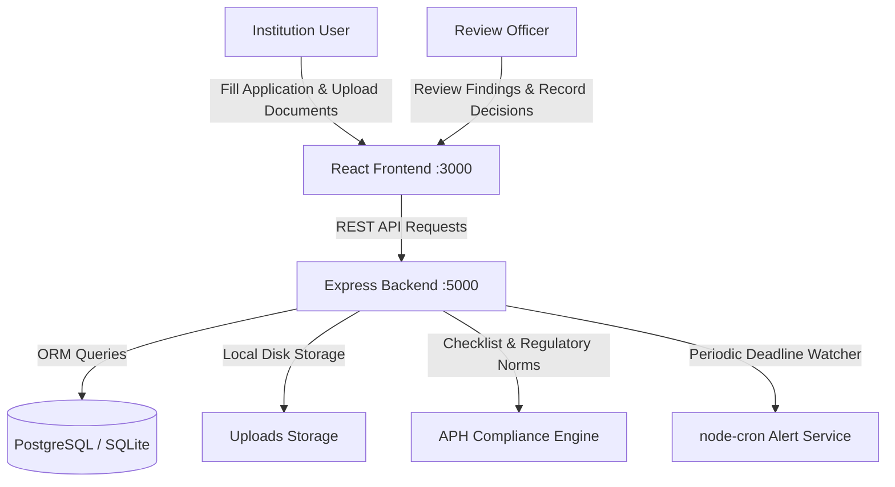

# AICTE Approval Workflow Automation, Compliance Monitoring and Alert Management System
> **Problem Statement:** SIH26262 — Smart India Hackathon 2026  
> An end-to-end e-Governance portal for AICTE approval processing, automated APH norm verification (SFR, land, safety NOCs), interactive satellite cadastral plotting, and proactive deadline alert management.

---

## 🚀 Quick Start (Windows)

To start the entire application with one click:

1. Double-click **`start.bat`** in the root directory.
2. The script will automatically:
   - Check Node.js and dependencies (auto-installs if missing)
   - Verify environment configuration & database connectivity (auto-detects PostgreSQL or auto-switches to portable SQLite)
   - Launch both the **Backend API Server** (`:5000`) and **Frontend** (`:3000`) together
   - Open your default web browser directly to `http://localhost:3000`
3. To stop the application at any time, simply press **`Ctrl + C`** in the terminal window.

---

## 🔑 Demo Login Accounts

| Role | Email | Password | Name / Designation |
| :--- | :--- | :--- | :--- |
| **Institution User** | `institution@demo.aicte` | `demo123` | Dr. Rajesh Kumar *(Principal, Delhi Institute of Tech & Engg)* |
| **Review Officer** | `officer@demo.aicte` | `demo123` | Ms. Priya Sharma *(AICTE Scrutiny Officer)* |
| **Regional Director** | `officer2@demo.aicte` | `demo123` | Dr. Arvind Swaminathan *(Regional Director)* |

> **Note:** The login screen also features 1-click **Quick Login** buttons to sign in instantly without typing.

---

## 🏗️ System Architecture & Workflow



### 1. Multi-Step Application Workflow
- **Category Selection:** Extension of Approval (EoA), New Programme / Course, Increase in Intake, Supernumerary Quota.
- **Institutional & Academic Information:** Faculty strength, student enrollment, campus land area, location zoning (Urban / Rural), affiliating university.
- **Document Repository:** Mandatory upload handling for Fire Safety NOC, Structural Stability Certificate, Occupancy Permit, Land Registration Deed, and Audited Financial Balance Sheet.

### 2. Automated Regulatory Compliance Engine
- Evaluates rules as defined in the **AICTE Approval Process Handbook (APH 2025-26)**:
  - **Mandatory Field Integrity:** Verified before progression.
  - **Student-to-Faculty Ratio (SFR):** Automated calculation checking against the mandatory **1:20** benchmark.
  - **Land & Built-Up Area:** Checks minimum land requirements (>= 2.5 acres urban / >= 7.5 acres rural).
  - **Document Completeness:** Blocks submission if statutory safety certificates are missing or expired.
  - **AI Compliance Advisor:** Explanations detailing exact APH clauses for every warning or deficiency.

### 3. Interactive GIS Satellite Cadastral Map
- Live Google Satellite and street orthophotos powered by Leaflet.
- Cadastral parcel boundary polygon verification with clickable DGPS survey pillars (`P1`–`P6`).
- Instant contiguity verification ensuring the campus is a single contiguous undivided parcel.

### 4. Scrutiny Officer Portal
- **Scrutiny Workload Queue:** Filter applications by status, category, and overdue urgency.
- **Interactive Review:** Add internal remarks, request deficiencies with custom notes, advance status through review phases, and issue formal approval / rejection decisions.
- **Deficiency Rectification Workflow:** Automatically sends alerts to the institution, transitions state to `CORRECTION_REQUIRED`, and accepts resubmissions.

### 5. Alert & Deadline Management
- Background cron worker evaluates impending review deadlines:
  - Highlights applications approaching statutory deadlines (< 3 days).
  - Flags overdue items with prominent badges and priority notifications.
- In-app notification center with read/unread filtering and instant updates.

### 6. Interactive Reports & Analytics
- Visual distributions using **Recharts**:
  - Applications by Status
  - Applications by Category
  - Officer Workload & Caseload
  - Deadline Compliance Breakdown

### 7. Comprehensive Audit Trail
- Append-only event history tracking every user action, status transition, document upload, and validation run.

---

## 📂 Project Structure

```
aicte-compliance-alert-system/
├── start.bat                   # 1-click startup, dependency check & launcher
├── README.md                   # System documentation
├── backend/
│   ├── src/
│   │   ├── index.ts            # Express server entry point & middleware
│   │   ├── prisma.ts           # PrismaClient instance
│   │   ├── middleware/         # JWT authentication & role-based access guards
│   │   ├── routes/             # REST API route handlers (Auth, Apps, Docs, Reports, etc.)
│   │   ├── services/           # APH compliance rules validation engine
│   │   └── jobs/               # node-cron automated deadline monitor
│   ├── prisma/
│   │   ├── schema.prisma       # Database schema (PostgreSQL / SQLite)
│   │   └── seed.ts             # Realistic demo dataset seeder
│   └── uploads/                # Document attachment storage
└── frontend/
    ├── src/
    │   ├── components/         # GIS Map, Application Tracker, Modals, Layout
    │   ├── pages/              # Applications, Scrutiny, Audit Trail, Reports, Dashboard
    │   └── services/           # Axios REST client
    └── package.json
```

---

## 🛠️ Manual Development Setup

If you prefer running backend and frontend in separate terminals:

### Backend:
```bash
cd backend
npm install
npm run dev
```

### Frontend:
```bash
cd frontend
npm install
npm run dev
```
